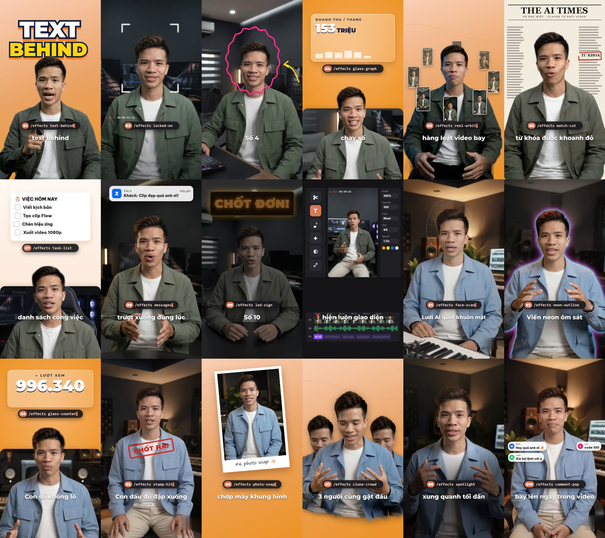
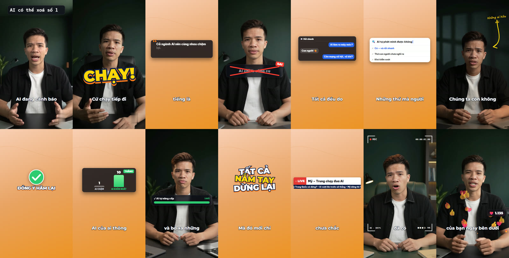
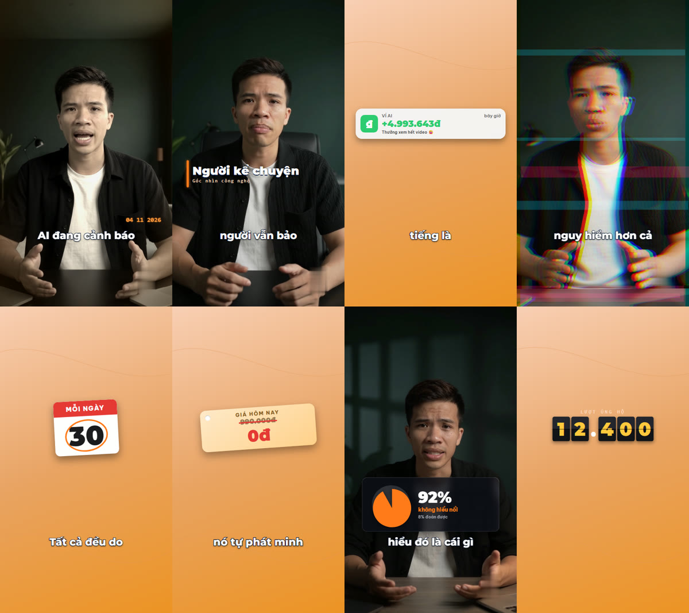

# MRT Keyword — tự dựng video từ A đến Z bằng Claude Code hoặc Codex

Đưa vào **một video quay người nói** hoặc **một file giọng đọc**, rồi gõ `/mrtkeyword` trong Claude Code hoặc `$mrtkeyword` trong Codex. Trợ lý AI sẽ tự nghe lời, cắt khoảng lặng và chỗ vấp, chọn hiệu ứng hợp từng câu, viết nội dung cho hiệu ứng, thêm phụ đề, nhạc nền, âm thanh hiệu ứng, ảnh bìa rồi xuất video dọc 9:16 sẵn đăng TikTok, Reels, Shorts.



*Ảnh cắt từ hai video "Top 10 keyword tạo video trong Claude" dựng bằng bộ skill này. Bộ skill do [Phúc Anh MRT](https://phamphucanh.com) xây dựng và chia sẻ miễn phí.*

## Có gì bên trong

- **169 hiệu ứng**, trong đó **62 cái đã có code, dùng được ngay**:

  | Nhóm | Hiệu ứng |
  |---|---|
  | Chữ | text-behind, punch-headline, kinetic-pop, word-slam, typewriter, slot-word, strike-replace, decode-word |
  | Khung máy quay, ánh sáng, màu | locked-on, rec-frame, face-scan, photo-snap, spotlight, neon-outline, cinema-bars, film-grain, glitch-cut |
  | Vẽ tay | scribble, arrow-doodle, sticky-note, cross-out, check-stamp, head-stickers |
  | Số liệu | glass-graph, glass-counter, glass-compare, glass-pie, progress-bar, progress-ring, scoreboard, confetti-milestone, countdown, calendar-flip, milestone-timeline, price-tag |
  | Giao diện app | messages, task-list, ios-toggles, chat-bubble, comment-pop, ai-prompt, search-bar, bank-notify, like-burst, poll, star-review, glass-quote, terminal-command, incoming-call, follow-click, edit-timeline |
  | Bối cảnh | match-cut, led-sign, stamp-hit, hanging-sign, mind-map, news-ticker, name-bar |
  | Bay quanh người, kết | reel-orbit, clone-crowd, end-wall, cta-circle |
- **Tự động hoàn toàn**: trợ lý tự chọn keyword cho từng câu và tự viết số liệu, checklist, bình luận, chữ trên con dấu… theo đúng lời bạn nói.
- **Không chèn chữ lên mặt**: thẻ và sticker tự tránh khuôn mặt, phụ đề có vùng riêng.
- **Dùng được cả khi chỉ có giọng đọc**: hiệu ứng tự đặt giữa màn hình trên nền màu.
- **Một bộ cài, hai trợ lý**: dùng được với cả **Claude Code** và **Codex** (OpenAI).

### Demo hiệu ứng mới

Các ảnh dưới đây dựng từ một video thật. Khung có người là đoạn quay, khung nền cam là đoạn chỉ có giọng đọc.



*typewriter · word-slam · glass-quote · cross-out · chat-bubble · search-bar · arrow-doodle · check-stamp · glass-compare · progress-bar · kinetic-pop · news-ticker · rec-frame · like-burst*



*film-grain · name-bar · bank-notify · glitch-cut · calendar-flip · price-tag · glass-pie · scoreboard*

## Cần có

- Windows 10 hoặc 11, kết nối Internet lúc cài, ổ cứng trống khoảng 10 GB.
- Một trong hai trợ lý:
  - **Claude Code**: ứng dụng Claude cho máy tính (tab Code) với gói Pro hoặc Max;
  - **Codex**: Codex CLI, ứng dụng Codex hoặc tiện ích Codex trong VS Code, đăng nhập bằng tài khoản ChatGPT.
- Card NVIDIA giúp chạy nhanh hơn nhiều, nhưng **không bắt buộc**.

## Cài đặt (một lần)

1. Bấm nút **Code → Download ZIP** ở đầu trang này, rồi giải nén vào một thư mục cố định, ví dụ `D:\MRTKeyword`.
2. Nhấp đúp **`CAI-DAT.bat`**. Lần đầu mất khoảng 15–30 phút. File cài sẽ tự làm các việc sau:
   - cài Node.js, Python 3.12 và FFmpeg nếu máy chưa có;
   - tạo môi trường Python riêng cho skill;
   - tải mô hình nghe lời (Whisper, khoảng 1,6 GB), mô hình tách người (khoảng 15 MB) và trình duyệt dùng để xuất video;
   - cài thư viện dựng video Remotion;
   - gắn skill cho **Claude Code** (`C:\Users\<bạn>\.claude\skills\mrtkeyword`) và **Codex** (`C:\Users\<bạn>\.agents\skills\mrtkeyword`).
3. Thấy dòng **XONG!** là cài xong. Sau khi cài, mọi bước dựng video đều chạy được không cần mạng.

> Sau khi cài, đừng xoá hay di chuyển thư mục đã giải nén vì skill chạy từ đó. Muốn chuyển chỗ thì chuyển xong chạy lại `CAI-DAT.bat`.

## Cách dùng

**Claude Code**: mở ứng dụng Claude (tab Code), kéo thả file video hoặc âm thanh vào khung chat rồi gõ:

```
/mrtkeyword dựng video này
```

**Codex**: mở Codex (nếu đang mở thì khởi động lại để nạp skill mới), gõ `$mrtkeyword` kèm đường dẫn file:

```
$mrtkeyword dựng video D:\Video\bai-noi.mp4
```

Bạn có thể thêm nhạc nền hoặc ảnh minh hoạ, ví dụ: *"/mrtkeyword dựng video này, nhạc nền là nhac.mp3, đoạn nói về sản phẩm thì chèn ảnh sanpham.png"*. Muốn xem ảnh trước khi xuất thì thêm *"gửi ảnh cho tôi duyệt trước"*.

Video xong nằm trong `Videos\Keyword FX\Thanh pham`, kèm ảnh bìa và gợi ý tiêu đề, caption Facebook và caption TikTok.

> **Lưu ý cho Codex**: Codex chạy lệnh trong môi trường giới hạn (sandbox). Khi Codex xin quyền ghi file ra thư mục `Videos` hoặc chạy lệnh dựng video, hãy bấm cho phép. Nếu không cho ghi ra ngoài, video sẽ được lưu trong thư mục bạn đang mở Codex.

## Muốn thêm hiệu ứng

Còn 107 hiệu ứng trong `mrtkeyword/keywords.json` đã có mô tả nhưng chưa có code. Bảo trợ lý: *"dựng keyword tier-list"*, trợ lý sẽ viết code, chạy thử rồi thêm vào thư viện.

## Gặp lỗi

- **`CAI-DAT.bat` báo thiếu winget**: cài "App Installer" từ Microsoft Store, rồi chạy lại.
- **Báo FFmpeg chưa vào PATH**: đóng cửa sổ, nhấp đúp `CAI-DAT.bat` lần nữa.
- **Gõ `/mrtkeyword` hoặc `$mrtkeyword` mà không nhận**: khởi động lại Claude hoặc Codex. Trong Codex, gõ `/skills` để xem skill đã được nạp chưa.

## Về tác giả

MRT Keyword do **Phúc Anh MRT** xây dựng trong quá trình làm video ngắn bằng AI mỗi ngày, rồi đóng gói lại để mọi người dùng chung.

Nếu bạn muốn học cách dựng video bằng AI bài bản hơn, hoặc cần người làm cùng, có thể ghé [phamphucanh.com](https://phamphucanh.com). Các video hướng dẫn được đăng trên kênh YouTube [@PhucAnhMRT](https://www.youtube.com/@PhucAnhMRT).

Bộ skill dùng được bình thường mà không cần đăng ký hay để lại thông tin gì. Nếu thấy hữu ích, hãy gửi cho một người bạn cũng đang làm video.
